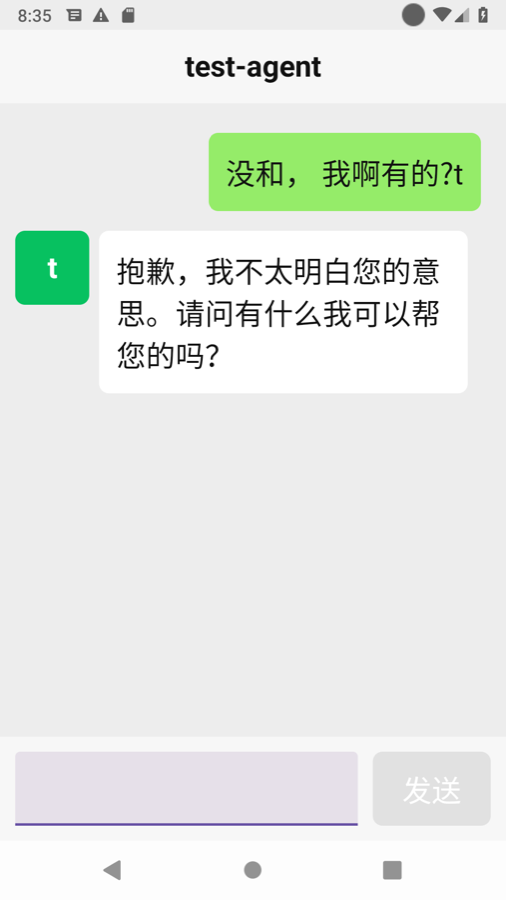

# Whatcha · 在干嘛

[中文](README.zh-CN.md)

**Whatcha is a one-screen Android app for parents. They use it to chat with their child's AI agent.**

The agent runs on the child's machine and knows what the child has been up to. When a parent asks "what are you doing?", the agent answers in the child's voice. The child can step into the same chat at any time.

The parent configures nothing and never sees an account, an address or a setting. All setup is done on the agent's side.



## Status

This is early work. The first milestone works end to end. It was checked on 2026-11-03 against a ConnectOnion 1.9.3rc32 agent through the public relay.

What works today:

- **Pairing is packed into the APK.** The parent installs one file, opens it, and the app is already connected. Nothing is typed or pasted.
- **Silent identity.** The phone makes its own Ed25519 key on first launch.
- **Invite onboarding.** The app presents the invite code packed with it, and the agent accepts the phone as a contact.
- **Text chat.** Commands are signed, and the agent's name appears as the title.
- **Replies are read aloud.** Tapping a reply reads it again.
- **History is kept** on the phone.

## How it works

```
child's agent ── tools/pack.py ──> whatcha-family.apk ──> parent's phone
      ^                                                         │
      └──────────── wss://oo.openonion.ai (relay) ─────────────┘
```

1. The child runs an agent that accepts an invite code.
2. `tools/pack.py` writes the agent's address and the invite code into a copy of the APK. The entry goes in the APK Signing Block, which the signature does not cover, so no re-signing and no signing key are needed.
3. On first launch the app reads that entry from its own installed APK, connects through the relay, and onboards with the code.

## Try it

Build the app and run the tests. You need JDK 17 and the Android SDK with API 36.

```bash
./gradlew :app:assembleDebug :app:testDebugUnitTest
```

Start an agent that accepts an invite code:

```bash
CO_INVITE_CODE=pick-a-code co host
```

Pack a copy for one family and install it:

```bash
python3 tools/pack.py app/build/outputs/apk/debug/app-debug.apk whatcha-family.apk \
  --agent 0xYOUR_AGENT_ADDRESS --invite pick-a-code
adb install whatcha-family.apk
```

## Roadmap

| Milestone | What |
|---|---|
| 1 ✅ | Packed pairing, silent identity, invite onboarding, text chat, read aloud |
| 2 | Hold-to-talk voice as the main input. The agent transcribes |
| 3 | A daily card from the agent: where the child is, what they are doing, the weather |
| 4 | The agent sets the titles, names and avatars the parent sees |
| 5 | Remote care: the agent can take a screenshot, change settings, read logs and update the app |
| 6 | Staying connected in the background on Huawei and other phones without Google services |

## Design rules

- **One screen.** There are no menus, contacts or settings for the parent.
- **Large by default.** Body text is 24sp and main targets are at least 60dp. This follows the main-text and target-size minimums of China's 2021 elderly-app spec from MIIT.
- **Plain sentences only.** The parent never sees an error code.

## License

MIT. See [LICENSE](LICENSE).
