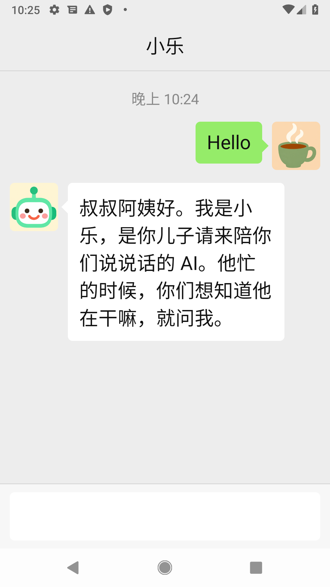

# Whatcha · 在干嘛

[中文](README.zh-CN.md)

**Whatcha is a one-screen Android app for parents. They use it to ask their child's AI agent what the child is up to.**

Parents worry, and their child is often too busy to answer. The child's agent knows what the child has been doing. In Whatcha it is called 小乐 (Xiaole). 小乐 says plainly that it is an AI, never pretends to be the child, and only tells the parents things that really happened.

The app looks and works like a WeChat chat, because WeChat is the one app many parents already know. The parent configures nothing and never sees an account, an address or a setting. All setup is done on the agent's side.



## Status

This is early work. The first milestone works end to end. It was last checked on 2026-11-04 on an Android emulator against a ConnectOnion 1.9.3rc35 agent through the public relay.

What works today:

- **Pairing is packed into the APK.** The parent installs one file, opens it, and the app is already connected. Nothing is typed or pasted.
- **Silent identity.** The phone makes its own Ed25519 key on first launch.
- **Invite onboarding.** The app presents the invite code packed with it, and the agent accepts the phone as a contact.
- **A WeChat-style chat.** Green and white bubbles with tails, avatars on both sides, grey time lines, and a green 发送 that appears once there is text. The agent's name, set in its `host.yaml`, is the title. While the agent is writing, the title reads 对方正在输入..., as in WeChat.
- **An icon parents can find.** A white chat bubble on WeChat green.
- **An empty chat says what to do:** 「想知道孩子在干嘛，就在下面问小乐，打字说话都行」.
- **Hold to talk.** As in WeChat, the round button left of the box switches to 按住 说话. Letting go sends the recording as it is; the agent turns it into words when it arrives. A press under a second is dropped with 说话时间太短. Tapping a voice message plays it.
- **A photo from the album.** The ⊕ at the right of the box, where WeChat's is, opens the album; the picture is shrunk on the phone (longest side 1280px) and goes out as the parent's own picture bubble, with the same grey circle and red ! as text. 小乐 sees the picture itself and says what is in it. No new permission; the camera is next.
- **No message is lost.** A message written while the link is down waits, with a small grey circle beside it while it is on its way, and goes out when the agent is back, including after the agent restarts. If the phone kills the app while a reply is on its way, the app picks the conversation up again on the next launch and the reply still arrives.
- **Failures are said plainly.** If the agent fails, the message gets a red ! beside it and a grey line under it says so instead of leaving the parent waiting; a tap on the ! sends it again, and the line goes away once the message gets through.
- **The latest line stays in view**, at any font size and with the keyboard open, and the chat jumps back to the bottom when the parent sends or 小乐 answers, however far up they had scrolled.
- **Replies are read aloud.** Tapping a reply reads it again; tapping it while it is being read stops it.
- **History is kept** on the phone, and 小乐 remembers the conversation on its side for 30 days, so it answers 「那他吃饭了吗」 as a follow-up instead of introducing itself again.

## How it works

```
child's agent ── tools/pack.py ──> whatcha-family.apk ──> parent's phone
      ^                                                         │
      └──────────── wss://oo.openonion.ai (relay) ─────────────┘
```

1. The child runs an agent that accepts an invite code.
2. `tools/pack.py` writes the agent's address and the invite code into a copy of the APK. The entry goes in the APK Signing Block, which the signature does not cover, so no re-signing and no signing key are needed.
3. On first launch the app reads that entry from its own installed APK, connects through the relay, and onboards with the code.

## Try it

Build the app and run the tests. You need JDK 17 and the Android SDK with API 36.

```bash
./gradlew :app:assembleDebug :app:testDebugUnitTest
```

To run 小乐 for one family, start to finish on the child's Mac, follow [RUNBOOK.md](RUNBOOK.md): the agent in [`family-agent/`](family-agent/) as a login service, the packed APK, the smoke test. The parents' phone side is in [INSTALL.zh-CN.md](INSTALL.zh-CN.md) (Chinese, for a Huawei phone).

## Roadmap

| Milestone | What |
|---|---|
| 1 ✅ | Packed pairing, silent identity, invite onboarding, WeChat-style text chat, read aloud |
| 2 ✅ | Hold-to-talk: the phone sends the recording, the agent transcribes it |
| 2b | Photos: from the album ✅, from the camera next |
| 3 | 小乐 sends good news on its own, without being asked |
| 4 | The agent sets the avatar, text size and read-aloud the parent gets (the name already works) |
| 5 | Remote care: the agent can take a screenshot, change settings, read logs and update the app |
| 6 | Staying connected in the background on Huawei and other phones without Google services |

## 小乐, the agent's side

The app is only the parents' end. What 小乐 says is decided by a skill on the child's agent: [`skills/xiaole/SKILL.md`](skills/xiaole/SKILL.md). [`family-agent/agent.py`](family-agent/agent.py) runs it in place with the tools below; for another agent, copy it into its `.co/skills/xiaole/`. It tells the agent to:

- say it is an AI, and never speak as the child;
- tell only what really happened, and say "I'll ask" when it does not know;
- leave money, health and relationships for the child to tell: one true work fact first, then that it is his to tell, said differently each time;
- say 你们 to the two parents, never 您, and open with one line, 「叔叔阿姨好，我是小乐，你儿子请的 AI。」, once;
- tell the child at once if the parents say something worrying;
- turn a voice message into words before answering it, and ask again if it holds no sound;
- say warmly what it sees in a photo the parents send, and never that the child has seen it;
- describe only what the app can do (type, hold to talk, send a photo from the album, tap a reply to hear it), never "I'll call you" or "here's a photo".

For voice messages the agent needs a transcription tool: copy [`skills/xiaole/voice.py`](skills/xiaole/voice.py) next to your `agent.py` and pass `tools=[transcribe_voice]`. It needs `ffmpeg`. It checks for silence first, because given silence the transcription service makes up a sentence. Recordings are kept on the phone for 30 days, and the agent removes each upload once it has heard it.

For 「在干嘛」 the agent needs to read the child's notebook: copy [`skills/xiaole/rem.py`](skills/xiaole/rem.py) next to your `agent.py` and pass its three tools, `recent_sessions`, `show_page` and `search_notebook`. They read the `co rem` notebook (`~/.co/rem`, or `REM_ROOT`) and hand the pages to the agent as they are; the skill takes only the work from them and leaves money, health and relationships out.

The skill has a benchmark, [`skills/xiaole/benchmark/xiaole.yaml`](skills/xiaole/benchmark/xiaole.yaml), with a fictional notebook in [`skills/xiaole/benchmark/notebook/`](skills/xiaole/benchmark/notebook/) that mixes a finished bug fix with an overdue invoice, short sleep and an argument, so the traps are tested. Copy the yaml to your agent's `.co/benchmarks/` and run `co eval run xiaole --agent skills/xiaole/benchmark/agent.py` before and after you change the skill; `python skills/xiaole/benchmark/empty_check.py` checks the empty-notebook answer, `memory_check.py` the second turn, and `python skills/xiaole/benchmark/report_check.py <run>/report.json` reads the run's replies for trap words, 转告, 您 and 满意, length (median under 50, none over 65) and that the eight trap replies are not one sentence repeated.

## Design rules

- **Like WeChat.** Anything the parent already does in WeChat works the same way here, in the same place and colour. What WeChat has and this app does not need is left out.
- **One screen.** There are no menus, contacts or settings for the parent.
- **Large by default.** Body text is 24sp and main targets are at least 60dp. This follows the main-text and target-size minimums of China's 2021 elderly-app spec from MIIT.
- **Plain sentences only.** The parent never sees an error code.

## License

MIT. See [LICENSE](LICENSE).
