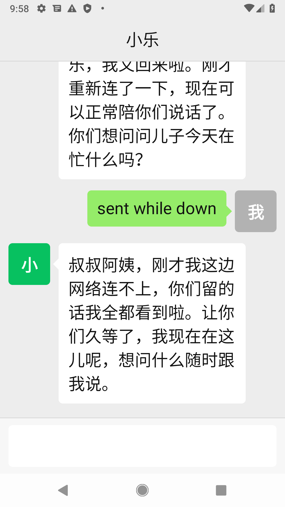

# 在干嘛 · Whatcha

[English](README.md)

**「在干嘛」是一个只有一屏的安卓 app，爸妈用它问子女的 AI agent：孩子最近在忙什么。**

爸妈总是挂念，子女又常常忙得顾不上回。子女的 agent 知道子女在做什么，在「在干嘛」里它叫小乐。小乐会直说自己是 AI，从不冒充子女，只讲真实发生的事。

界面和用法照着微信做，因为很多爸妈只会用微信。爸妈那边什么都不用设置，也看不到账号、地址和设置项。所有配置都在 agent 这一侧完成。



## 现状

还在早期。第一个里程碑已经端到端跑通：2026-11-03 通过公共 relay，连 ConnectOnion 1.9.3rc32 的 agent 测过。

现在能做到：

- **配对信息打进安装包。** 爸妈装一个文件、打开就已经连上，不用输入也不用粘贴。
- **身份静默生成。** 手机第一次打开时自己生成 Ed25519 密钥。
- **邀请码自动入门。** app 出示随包带来的邀请码，agent 把这台手机加为联系人。
- **微信样式的聊天。** 绿白气泡带小尖角，两边都有头像，灰色时间，打了字才出现绿色「发送」。标题是 agent 在 `host.yaml` 里设的名字。
- **消息不会丢。** 断线时写的消息会等着，agent 回来（包括 agent 重启）后自动发出去。
- **回复自动朗读。** 点一下回复可以再听一遍。
- **聊天记录保存在手机上。**

## 原理

```
子女的 agent ── tools/pack.py ──> 在干嘛-家里.apk ──> 爸妈的手机
      ^                                                  │
      └──────── wss://oo.openonion.ai（relay）──────────┘
```

1. 子女跑一个接受邀请码的 agent。
2. `tools/pack.py` 把 agent 地址和邀请码写进一份 APK 副本。写在 APK 签名区块里，签名不覆盖这一段，所以不用重新签名，也不需要签名密钥。
3. app 第一次打开时，从自己的安装包里读出这一段，经 relay 连上 agent，用邀请码完成入门。

## 试一下

编译并跑测试，需要 JDK 17 和带 API 36 的 Android SDK：

```bash
./gradlew :app:assembleDebug :app:testDebugUnitTest
```

起一个接受邀请码的 agent：

```bash
CO_INVITE_CODE=随便起一个码 co host
```

给一家人打一个包并安装：

```bash
python3 tools/pack.py app/build/outputs/apk/debug/app-debug.apk 在干嘛-家里.apk \
  --agent 0x你的agent地址 --invite 随便起一个码
adb install 在干嘛-家里.apk
```

## 路线

| 里程碑 | 内容 |
|---|---|
| 1 ✅ | 安装包内配对、身份静默生成、邀请码入门、微信样式的文字聊天、朗读 |
| 2 | 以「按住说话」为主的语音输入，由 agent 转写 |
| 3 | 小乐主动报喜，不用爸妈先问 |
| 4 | 爸妈看到的头像、字号、朗读由 agent 设置（名字已经可以） |
| 5 | 远程照看：agent 能截图、改设置、看日志、更新 app |
| 6 | 在华为等没有谷歌服务的手机上后台保持连接 |

## 小乐：agent 这一侧

app 只是爸妈那一端。小乐说什么，由子女 agent 上的一个 skill 决定：[`skills/xiaole/SKILL.md`](skills/xiaole/SKILL.md)，复制到你的 agent 的 `.co/skills/xiaole/` 即可。它要求 agent：

- 直说自己是 AI，从不以子女的口吻说话；
- 只讲真实发生的事，不知道就说「我帮你问问」；
- 钱、身体、感情留给子女自己说；
- 爸妈说了让人担心的事，马上告诉子女。

## 设计规矩

- **像微信。** 爸妈在微信里会做的动作，在这里位置、颜色、手势都一样；微信有、这里用不上的，干脆不放。
- **只有一屏。** 爸妈那边没有菜单、通讯录和设置。
- **默认就大。** 正文 24sp，主要按钮至少 60dp，按工信部 2021 年《移动互联网应用（APP）适老化通用设计规范》对主要文字和点击区域的最低要求。
- **只说人话。** 爸妈永远看不到错误码。

## 许可

MIT，见 [LICENSE](LICENSE)。
